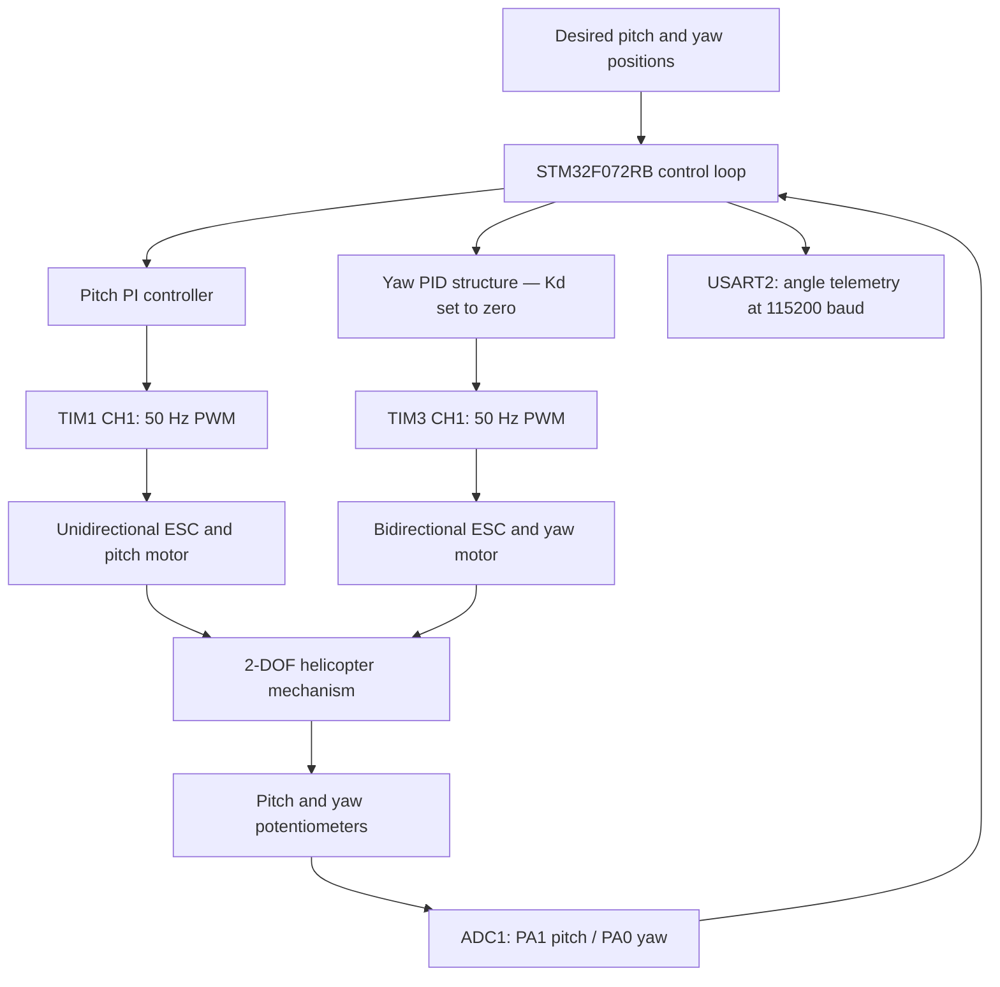

[README.md](https://github.com/user-attachments/files/34556333/README.md)
# 2-DOF Helicopter — STM32 Closed-Loop Pitch & Yaw Control

**Embedded C · STM32F072RB · Feedback Control · PI/PID · ADC · PWM · BLDC/ESC**

A two-degree-of-freedom (2-DOF) helicopter control project using an STM32 microcontroller, potentiometer-based position feedback, and PWM-controlled electronic speed controllers (ESCs). The firmware implements independent control paths for the **pitch** and **yaw** axes and streams angle data over UART for monitoring and analysis.

> **Project status:** This repository includes the STM32 `Core/` source files supplied for this project. The control strategy and configuration below are described from the source code. Performance plots, a full STM32CubeIDE project, and reproducible experimental datasets are not included in this package.

## System overview



The diagram shows the functional control relationship rather than a schematic wiring diagram. Each ESC receives a command signal; this firmware **does not implement BLDC commutation or field-oriented control inside the ESC**.

## Hardware and firmware configuration

| Item | Implementation in supplied source |
| --- | --- |
| Microcontroller | STM32F072RB (STM32F0 HAL) |
| Pitch position feedback | Potentiometer through ADC1 channel 1 / PA1 |
| Yaw position feedback | Potentiometer through ADC1 channel 0 / PA0 |
| Pitch ESC command | TIM1 channel 1, PA8, PWM |
| Yaw ESC command | TIM3 channel 1, PA6, PWM |
| PWM signal | 50 Hz; timer compare values correspond to pulse widths in microseconds |
| Control update target | 20 ms (50 Hz) main-loop scheduling |
| Telemetry | USART2, 115200 baud, `yaw_deg,pitch_deg` at a nominal 100 ms interval |
| Framework | STM32 HAL, polling-based main loop (no RTOS) |

## Control algorithms

### Pitch — PI position control

The pitch axis converts ADC readings to an approximate angle using a piecewise mapping around the potentiometer center. The controller calculates a pitch position error and generates a PWM command around an adjustable hover baseline.

- Proportional and integral correction of pitch position error
- Small-angle deadband
- Integral limiting and output-saturation anti-windup
- Output clamping and step-limited PWM changes
- Soft-start restriction on the permitted command range

The supplied pitch controller does **not** contain a derivative term.

### Yaw — PID-form position control

The yaw axis uses potentiometer ADC counts as the control-error domain and generates bidirectional ESC commands around a configurable neutral pulse width.

- Proportional, integral, and coded derivative calculations
- **Derivative gain is configured to zero in this firmware**, so the effective controller operates without derivative contribution
- Hard neutral lock when the position error is within the ADC deadband
- Integral scheduling, near-center integral freeze, integral leakage, and anti-windup logic
- Neutral PWM deadzone handling, minimum command effort, short kick behavior, and asymmetric slew limiting
- Automatic yaw-center reference captured when control is enabled

These design choices address small-position errors, ESC neutral behavior, and command saturation. Their real-world effectiveness must be established from physical tests.

## Start-up sequence and safety-related behavior

1. The firmware initializes HAL, GPIO, USART2, ADC1, TIM1, and TIM3.
2. ADC calibration and 50 Hz PWM initialization take place.
3. Pitch output is initially held at a minimum command and yaw at neutral.
4. The firmware applies an initial 3-second control-enable delay.
5. The current yaw potentiometer reading is captured as the yaw reference.
6. Control is enabled and PWM authority expands during a 1-second soft-start ramp.

The source includes saturation limits, neutral handling, and a defined startup sequence. These are **control precautions**, not proof of a comprehensive hardware safety system. ESC arming and physical safety should be reviewed before energizing motors.

## Telemetry and evaluation

The device sends a pair of angle estimates through USART2:

```text
yaw_deg,pitch_deg
```

The CSV-style stream can be captured and plotted in MATLAB, Python, or a serial terminal. Useful evaluation criteria include steady-state error, settling time, overshoot, response to disturbances, and actuator output saturation.

No measured response-time or tracking-accuracy figures are asserted here, because the supplied `Core.zip` does not include corresponding experimental logs or charts.

## Repository layout

```text
2dof-helicopter-pid-control/
├── README.md
└── Core/
    ├── Inc/
    │   ├── main.h
    │   ├── adc.h
    │   ├── gpio.h
    │   ├── tim.h
    │   ├── usart.h
    │   └── ...
    └── Src/
        ├── main.c        # Pitch / yaw control and main loop
        ├── adc.c         # ADC setup
        ├── tim.c         # PWM timer setup
        ├── usart.c       # UART setup
        └── ...
```

## Build notes

The `Core/` folder is **not a complete, directly buildable STM32CubeIDE project**. It contains the application sources and headers but does not include the full CubeIDE project configuration, STM32 HAL/CMSIS dependencies, linker script, or startup assets.

For an STM32F072RB project, the peripheral configuration and required dependencies must match the supplied code before compilation. Do not assume generic board wiring or compatible ESC calibration.

## Scope

This repository documents the embedded control firmware supplied for a university 2-DOF helicopter project. It does not claim autonomous flight, FOC motor-drive design, or results not supported by the included source. Controller parameters are hardware- and experiment-specific and should be validated on the intended test bench.
